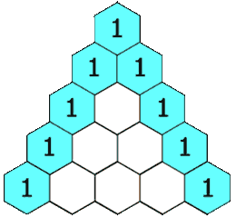

# Q33. Pascal's Triangle II

- **LeetCode:** <https://leetcode.com/problems/pascals-triangle-ii/> (#119, Easy)

## Problem


<sub>source: https://upload.wikimedia.org/wikipedia/commons/0/0d/PascalTriangleAnimated2.gif</sub>

Given an integer rowIndex, return the rowIndex-th (0-indexed) row of Pascal's
triangle.

In Pascal's triangle, each number is the sum of the two numbers directly above
it, as shown:

```text
    row 0:              1
    row 1:            1   1
    row 2:          1   2   1
    row 3:        1   3   3   1
    row 4:      1   4   6   4   1
```

## Example 1

```text
Input:  rowIndex = 3
Output: [1,3,3,1]
```

## Example 2

```text
Input:  rowIndex = 0
Output: [1]
```

## Example 3

```text
Input:  rowIndex = 1
Output: [1,1]
```

## Constraints

```text
0 <= rowIndex <= 33
```

## Follow up

Could you optimize your algorithm to use only O(rowIndex) extra space?
